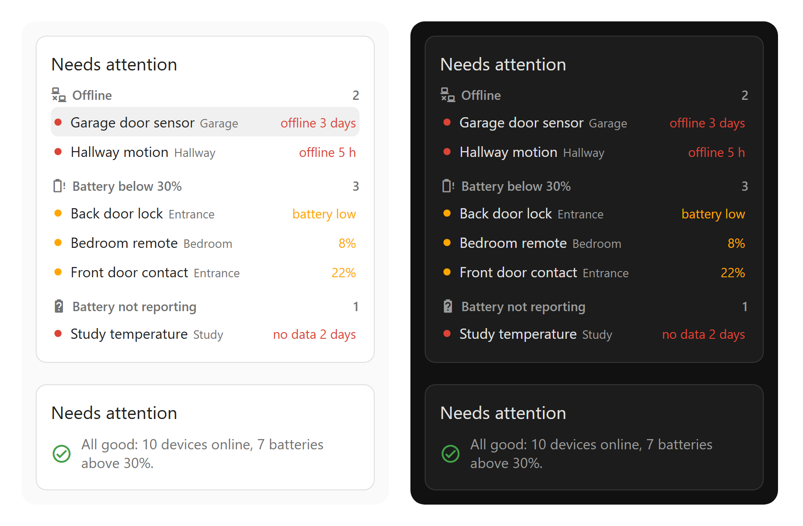

# Home Watchdog Card

A Home Assistant dashboard card that lists what needs a look right now: devices that have gone offline, batteries running low, and batteries that have stopped sending a level at all. It finds them by itself, so there is no list of entities to keep up to date.



I made it because things in my own house kept going quiet without me noticing. The first time I ran it on my dashboard it found a balcony light sensor and a voice satellite that had both been offline for six days, and a motion sensor down to 5%.

## What it shows

Offline devices are grouped by device, so a Zigbee sensor with four entities shows up once. A device counts as offline when all of its main entities are unavailable for longer than 10 minutes, which keeps a plug that reboots for a moment off the list. Diagnostic entities such as signal strength are left out of that test.

Low batteries are any battery sensor under 30% (you can change it), plus the on/off "battery low" sensors some locks and remotes have. Lowest comes first.

The last list is the one a normal battery card misses. When a battery sensor goes to unavailable or unknown but the device itself is still online, it gets its own line, because that is usually a device about to drop off.

Tap any row to open that entity. When nothing is wrong the card says so in one line, with how many devices and batteries it is watching.

## Install

With HACS, tap this and confirm your Home Assistant address:

[](https://my.home-assistant.io/redirect/hacs_repository/?owner=paultuddenham&repository=home-watchdog-card&category=plugin)

Then press Download and reload the browser. If the button doesn't work for you, open HACS, choose the three-dot menu, then Custom repositories, and add `https://github.com/paultuddenham/home-watchdog-card` as type Dashboard.

By hand: copy `home-watchdog-card.js` to `/config/www/`, then add `/local/home-watchdog-card.js` as a JavaScript module under Settings, Dashboards, Resources.

Then add a card to a dashboard and pick Home Watchdog Card from the list. It works with no settings.

## Options

All of these can be set in the visual editor too.

```yaml
type: custom:home-watchdog-card
title: Needs attention       # empty string hides the title
battery_threshold: 30        # percent
min_offline_minutes: 10      # ignore drops shorter than this
max_items: 8                 # per list; the rest show as "and 3 more"
show_offline: true
show_batteries: true
show_browsers: false         # Browser Mod tabs, hidden by default
exclude:                     # entity ids, device names or platforms; * is a wildcard
  - sensor.*_phone_battery*
  - Old garage sensor
  - platform:mobile_app
```

Entities you have hidden in Home Assistant are skipped already. So are the browser tabs Browser Mod registers as devices, because a closed tab would otherwise sit on the list as offline forever.

## Getting told on your phone

The card only shows things while you are looking at it. If you want a message when a device drops or a battery gets low, I sell a set of blueprints that do that, with quiet hours and a daily summary instead of a ping per device: [Home Assistant Notification & Watchdog Pack](https://gumroad.com/l/rrchh). The card is free and stays free either way.

## Requirements

Home Assistant 2024.8 or newer. No other cards or integrations needed.

## Licence

MIT. Issues and pull requests are welcome.
